# AI-Career-Navigatorasdfvdf
## Проверка API через Postman

### 1. Регистрация пользователя
POST /auth/register — 201 Created

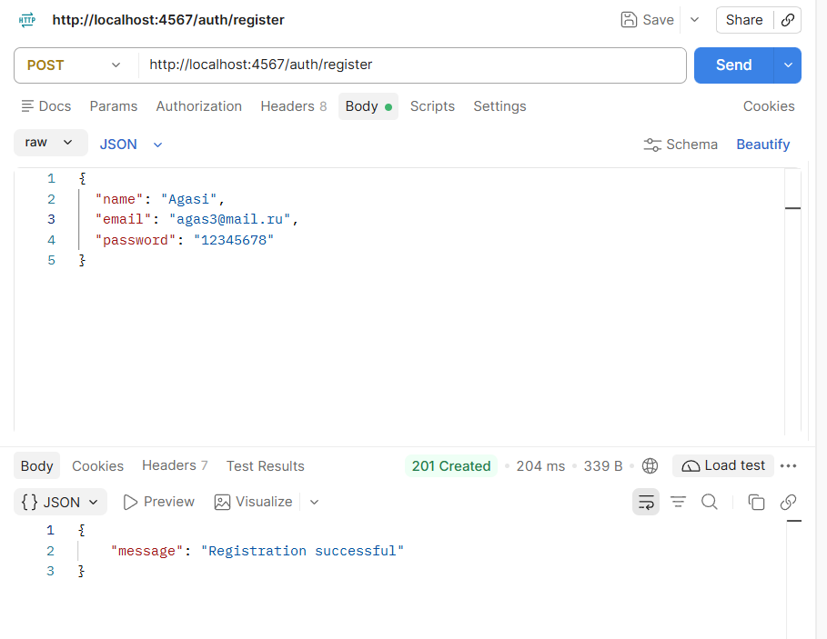

### 2. Авторизация и получение JWT
POST /auth/login — 200 OK

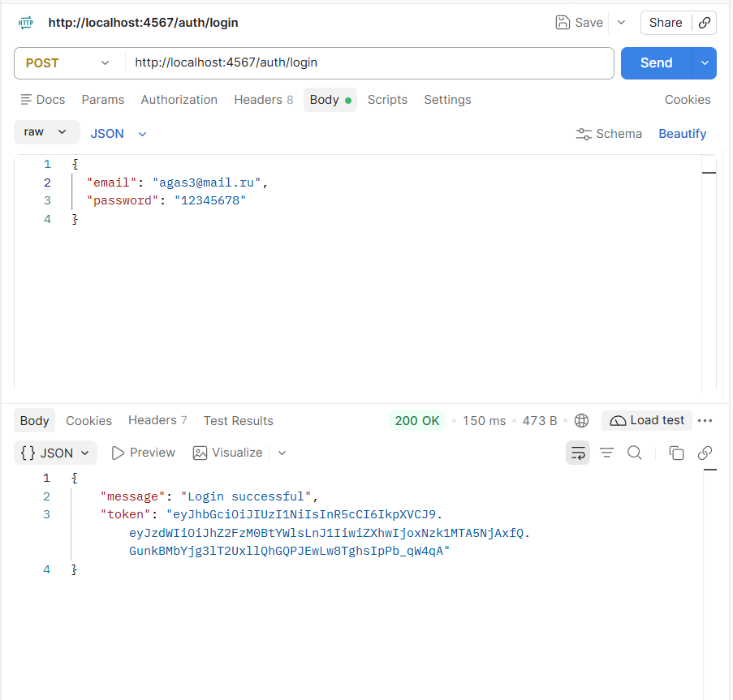

### 3. Получение профиля
GET /profile — 200 OK

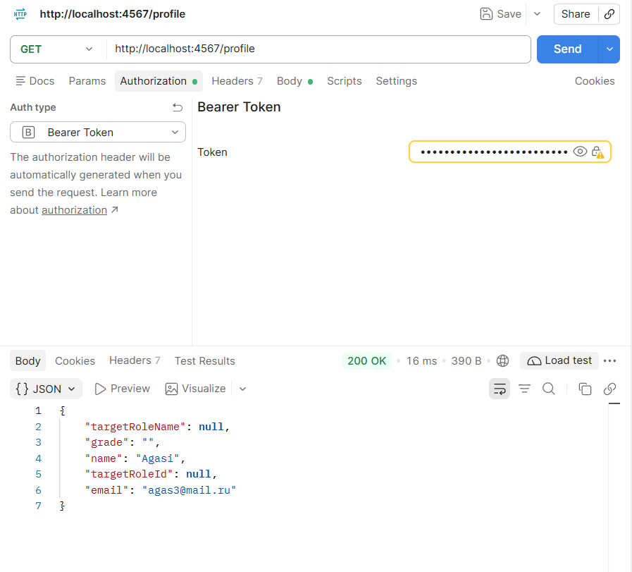

### 4. Изменение профиля
PUT /profile — 200 OK

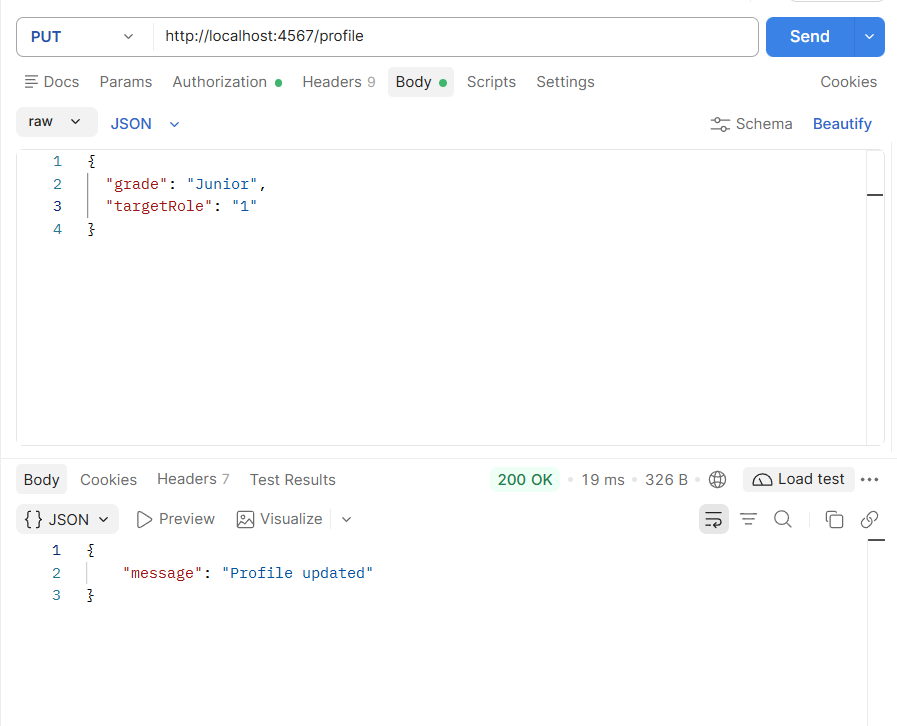

### 5. Сохранение самооценки навыка
PUT /skills/assessment — 200 OK

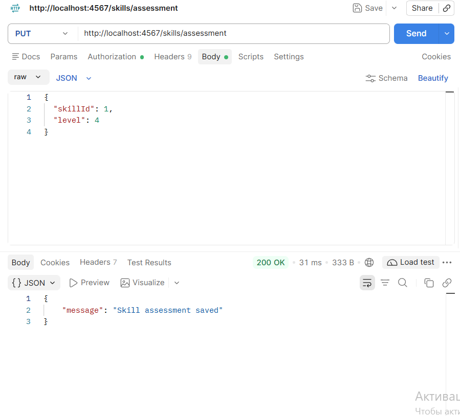

### 6. Получение самооценки
GET /skills/assessment — 200 OK

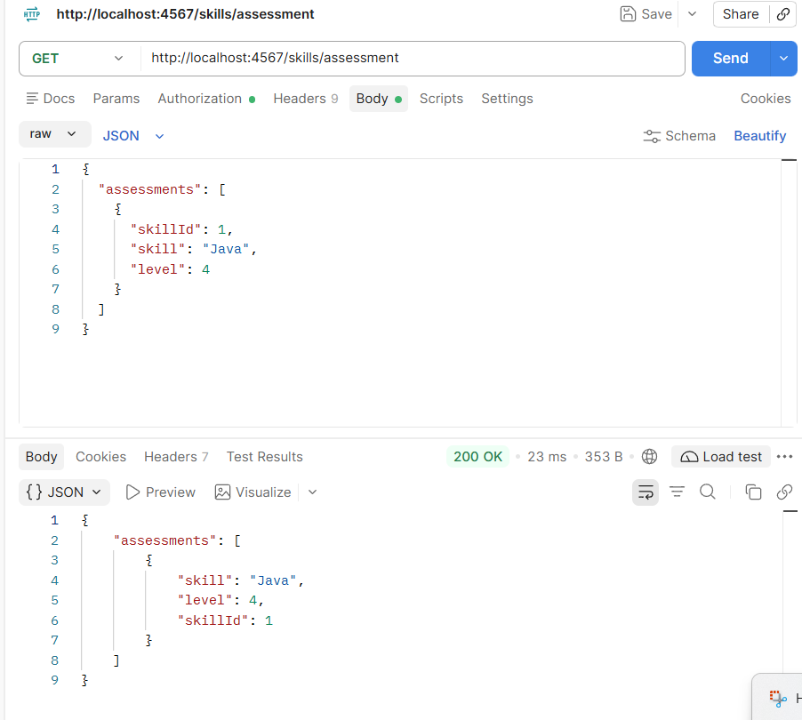

### 7. Обработка неправильного пароля
POST /auth/login — 401 Unauthorized

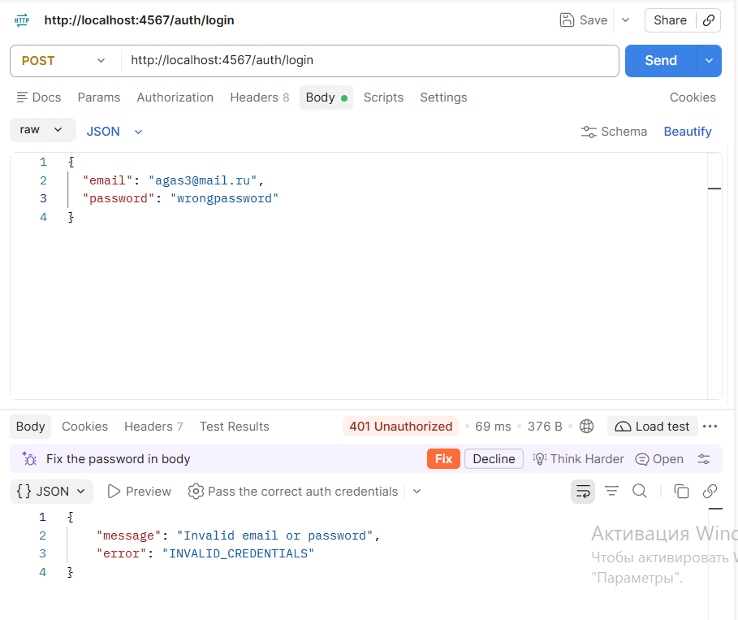

## PostgreSQL 18 — проверка через DBeaver

### Пользователи

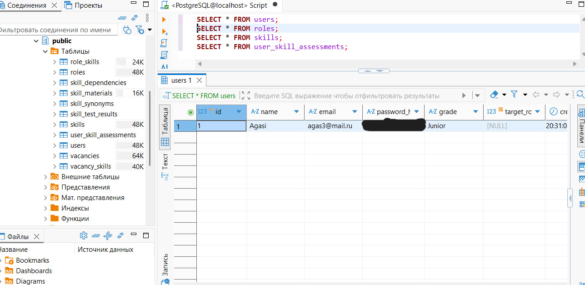

### Самооценка навыков

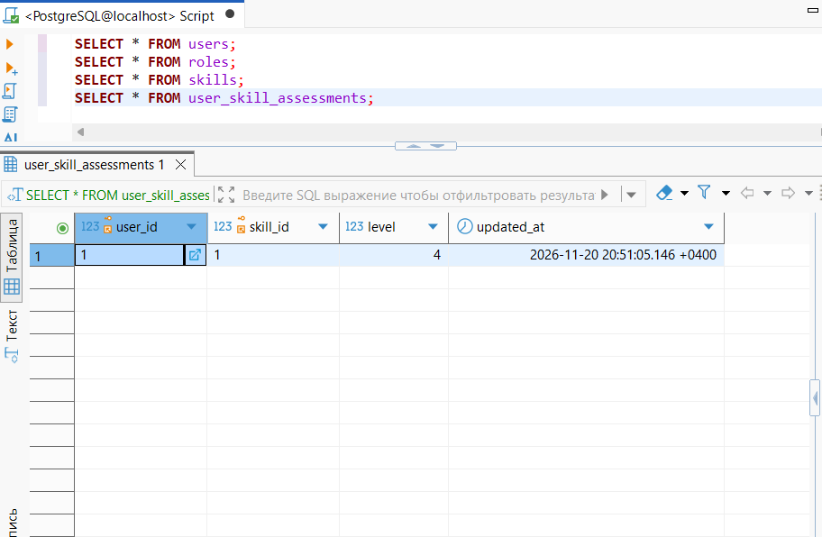

### Справочник навыков

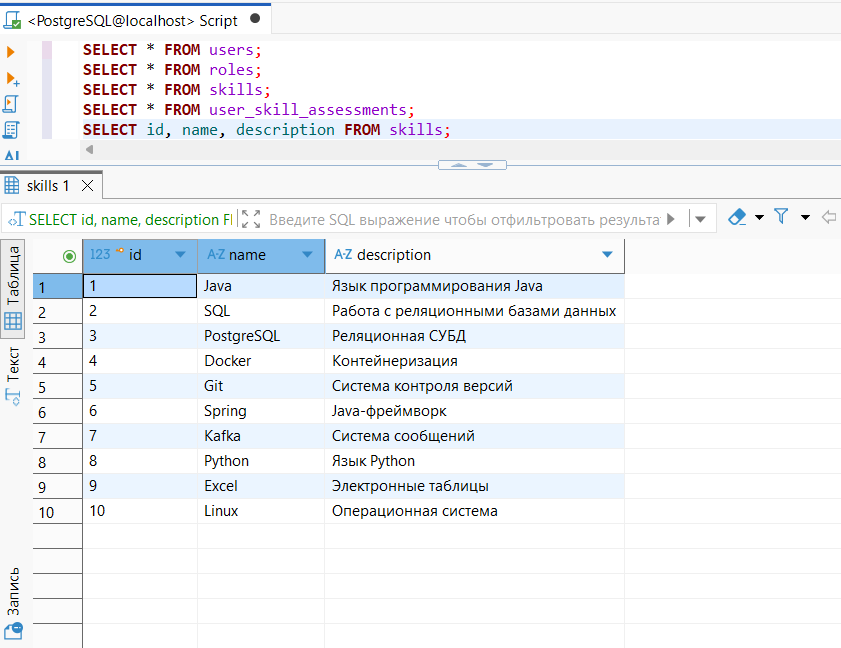

## Unit-тесты JUnit 5

Все 5 тестов успешно пройдены.

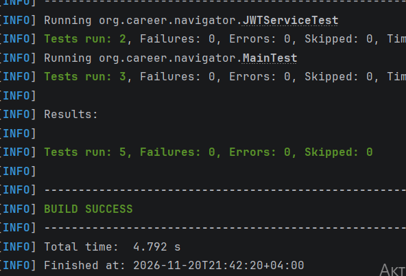
